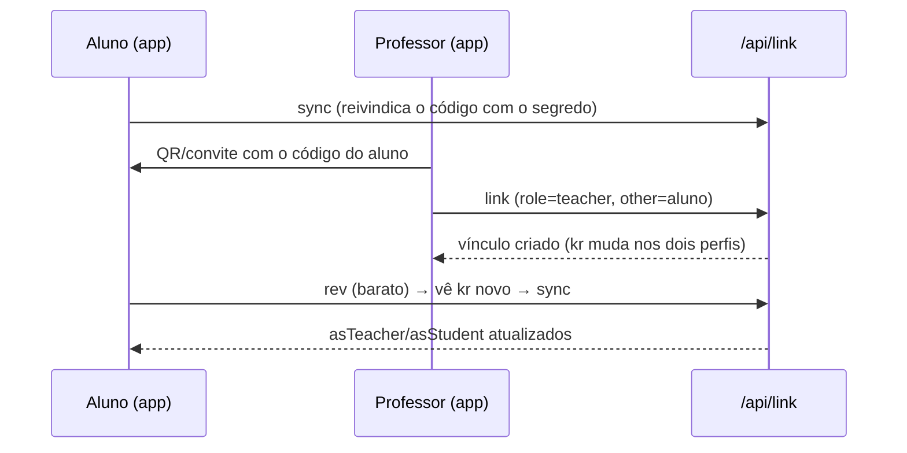
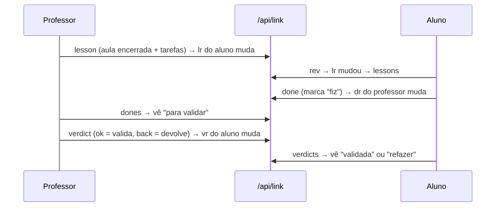
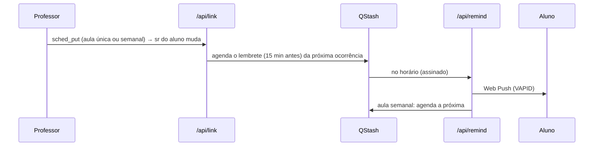
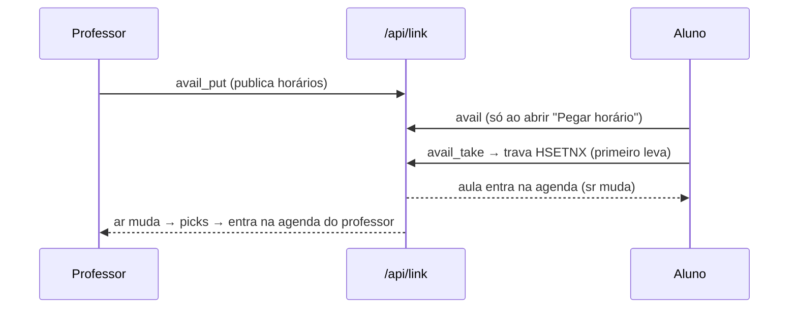
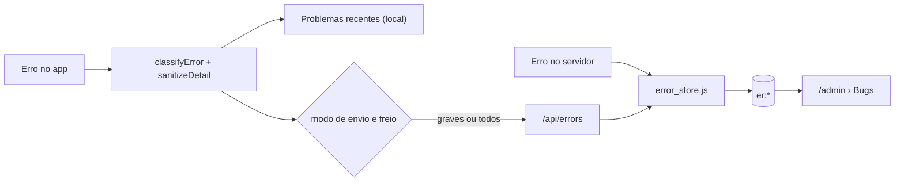

# Arquitetura

## Visão em camadas

```mermaid
flowchart LR
  subgraph Aparelho["Aparelho (navegador PWA, Android, iOS)"]
    UI["lib/ui<br/>telas Flutter"] --> AS["lib/app_state.dart<br/>estado central"]
    AS --> CORE["packages/afina_core<br/>regras em Dart puro"]
    AS --> PLAT["lib/audio, lib/platform<br/>microfone, som, push, instalar"]
    AS --> SVC["lib/link, lib/stats,<br/>lib/ai, lib/feedback"]
    AS --> LS[("SharedPreferences<br/>localStorage 'flutter.*'")]
  end
  subgraph Vercel["Vercel (funções em api/)"]
    L["/api/link"]:::f
    S["/api/stats"]:::f
    E["/api/errors"]:::f
    A["/api/admin"]:::f
    R["/api/remind"]:::f
    C["/api/coach + ai-status"]:::f
    F["/api/feedback"]:::f
  end
  SVC --> L & S & E & C & F
  L & S & E & A & R --> REDIS[("Upstash Redis<br/>REST")]
  R --> PUSH["Web Push (VAPID)"]
  L -. agenda lembrete .-> QSTASH["QStash"] --> R
  C --> IA["Gemini, OpenAI, Claude,<br/>Groq, Mistral, OpenRouter"]
  ADM["/admin (web/admin.html)"] --> A & S
  classDef f fill:#143,stroke:#2e8;
```

- **App (Flutter 3.47.9):** telas em `lib/ui`, um estado central (`AppState`, um `ChangeNotifier`), serviços de rede finos em `lib/link`, `lib/stats`, `lib/ai`, `lib/feedback`. **Tudo funciona offline**: o servidor só leva dados entre pessoas.
- **Núcleo (`packages/afina_core`):** Dart **puro** (sem Flutter, sem `dart:io`) com todas as regras que merecem teste: afinação, detector de altura, metrônomo, aulas, agenda, horários livres, status de tarefas, visões do hub, erros. É onde mora a lógica; a tela só desenha.
- **API (Node serverless, sem dependências npm):** uma função por arquivo em `api/`. Autenticação anônima por **código + segredo** (hash no servidor). Detalhes em [04_API_E_DADOS.md](04_API_E_DADOS.md).
- **Redis (Upstash, REST):** único armazenamento do servidor. Plano gratuito: 500 mil comandos/mês.
- **QStash:** agenda **uma** mensagem por vez (o próximo lembrete) que chama `/api/remind`, que envia o Web Push.
- **Vercel:** hospeda o site (build do Flutter web) e as funções. O build baixa o Flutter 3.47.9 (`scripts/vercel_build.sh`).

## O que fica onde
| Dado | Onde | Observação |
|---|---|---|
| Ajustes, histórico de estudo e de exercícios, alunos e tarefas do professor | **No aparelho** (`SharedPreferences`) | O professor tem seus alunos localmente; o servidor leva só o que cruza entre pessoas |
| Vínculos, aulas enviadas, decisões, agenda, horários livres | Redis | Só com vínculo online ligado |
| Estatísticas e relatórios de erro | Redis | Anônimos; agregados |
| Chaves e segredos | Variáveis de ambiente da Vercel | Nunca no repositório |

## Fluxos principais

### Vínculo professor ↔ aluno

### Aula, tarefa, "fiz" e validação

### Agenda e lembrete

### Horário livre

### Erro → painel

## Navegação do app
- **5 abas** (`lib/main.dart`, ordem em `lib/ui/home_tabs.dart`): Afinador · Metrônomo · **Meu espaço** (hub, no centro) · Grade · Escalas. **O app abre no Meu espaço.** A barra de cima tem só **Avisos** (sino) e **Minha conta**.
- **Meu espaço** mostra uma de duas **visões** (Aluno | Professor); cada destino aparece uma única vez por visão (regra em `hub_view.dart`, testada).
- Telas fundas abrem por `Navigator.push` a partir do hub; o botão voltar sempre volta ao ponto de partida.
- **Botão voltar do celular** (`PopScope` do `HomeShell`): numa tela funda volta uma tela; em outra aba volta ao Meu espaço; **no Meu espaço pergunta antes de sair** (`lib/ui/exit_sheet.dart`, "Já vai embora?"). O botão grande é **Continuar no app**; sair é um texto discreto; tocar fora, arrastar para baixo ou apertar voltar de novo significa ficar. Apertar voltar várias vezes seguidas nunca fecha o app (conferido no navegador com 6 voltas seguidas).

## Princípios que guiam o desenho
1. **Local primeiro**; a nuvem é opcional.
2. **Retrocompatível**: só acrescentar à API.
3. **Barato**: consulta de novidade custa ~0 (`rev`); listas só baixam quando um contador mudou.
4. **Regra no núcleo, tela fina**: o que tem regra tem teste em `packages/afina_core/test`.
5. **O professor é a fonte oficial** do status das tarefas.
